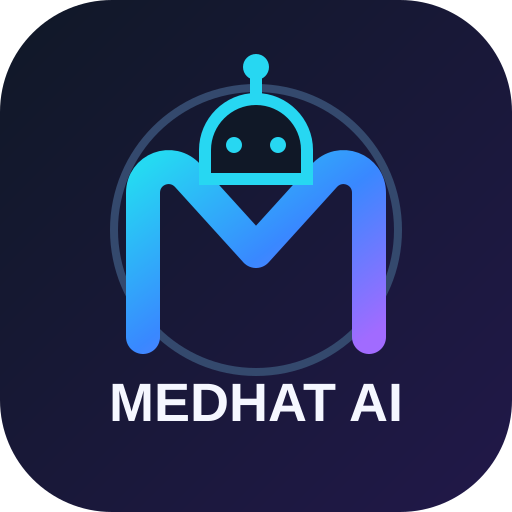

# Medhat AI



**الاسم الظاهر للتطبيق:** Medhat AI

مساعد ذكاء اصطناعي شخصي باللغة العربية، مصمم للاستخدام من الهاتف عبر المتصفح.

## العلامة التجارية وأيقونة الهاتف
- عنوان التطبيق وأيقونته داخل المتصفح مضبوطتان باسم **Medhat AI** وبشعار مخصص.
- إذا كان التطبيق مثبتًا مسبقًا على الشاشة الرئيسية، احذف الاختصار القديم ثم افتح رابط التطبيق بعد اكتمال النشر وأضفه إلى الشاشة الرئيسية مرة أخرى؛ قد يحتفظ Android/Chrome بالاسم والأيقونة القديمة في الاختصار السابق.

## الوظائف الحالية
- واجهة محادثة عربية.
- اتصال بمزود نماذج متوافق مع OpenAI Chat Completions.
- قراءة نصوص وPDF وDOCX وCSV وXLSX.
- بحث ويب تجريبي.
- ذاكرة أولية قابلة للحذف.

## النشر من الهاتف
1. اربط المستودع في Streamlit Community Cloud: https://share.streamlit.io/
2. اختر الفرع main والملف app.py.
3. في App Settings > Secrets أضف:
```toml
AI_API_KEY = "YOUR_PROVIDER_KEY"
AI_BASE_URL = "https://openrouter.ai/api/v1"
AI_MODEL = "openai/gpt-oss-20b:free"
```
4. تحقق من توافر النموذج وحدوده لدى مزود الخدمة قبل الاستخدام.

## تنبيهات
- لا تضع مفاتيح API في ملفات المستودع.
- الذاكرة المحلية قد لا تبقى بعد إعادة النشر أو إعادة تشغيل الاستضافة؛ نحتاج قاعدة بيانات دائمة مثل Supabase.
- البحث والقراءة والتحليل أدوات أولية تحتاج اختبارًا عمليًا.
- هذه نسخة MVP وليست وكيلًا مستقلًا مكافئًا لـ Manus. لا تنفذ أوامر النظام ولا تعدّل GitHub تلقائيًا حتى الآن.


## ربط الذاكرة الدائمة بـ Supabase

الكود يدعم الآن Supabase اختياريًا؛ من دون إعداداته يستمر في التخزين المحلي المؤقت.

1. أنشئ مشروعًا في Supabase وافتح SQL Editor ثم نفّذ:

```sql
create table if not exists public.memories (
  id bigint generated by default as identity primary key,
  category text not null,
  content text not null,
  created_at timestamptz not null default now()
);
alter table public.memories enable row level security;
grant select, insert, delete on public.memories to service_role;
grant usage, select on sequence public.memories_id_seq to service_role;
```

2. من إعدادات المشروع في Supabase انسخ Project URL ومفتاح Secret (أو مفتاح `service_role` القديم). المفتاح السري يجب أن يبقى في الخادم ولا يوضع في GitHub أو يشارك مع أحد.
3. في Streamlit Community Cloud افتح إعدادات التطبيق ثم Secrets وأضف:

```toml
SUPABASE_URL = "https://YOUR_PROJECT.supabase.co"
SUPABASE_SERVICE_ROLE_KEY = "YOUR_SERVER_SECRET_KEY"
```

4. أعد تشغيل التطبيق. ستظهر حالة الذاكرة الدائمة أعلى الصفحة إذا نجح الاتصال. اختبر حفظ معلومة ثم إعادة فتح التطبيق للتأكد من استمرارها.

مرجع الأمان: https://supabase.com/docs/guides/getting-started/api-keys


## مزوّدو الذكاء الاصطناعي والتبديل التلقائي\n\nيمكن إعداد Cloudflare Workers AI للمحادثة وتوليد الصور، مع مزوّدات بديلة اختيارية. يجرّب التطبيق Cloudflare أولًا في الوضع `auto` ثم ينتقل إلى المزوّدات الأخرى التي أُعدّت مفاتيحها إذا فشل الطلب. التبديل لا يخلق مفاتيح API ولا يضمن أن كل مزوّد مجاني. حصة Workers AI المجانية محدودة يوميًا؛ راجع الأسعار والموديلات الرسمية قبل الاستخدام.\n\nفي Streamlit Cloud → App settings → Secrets أضف: \n\n```toml\nAI_PROVIDER = "auto"\nCLOUDFLARE_ACCOUNT_ID = "YOUR_ACCOUNT_ID"\nCLOUDFLARE_API_TOKEN = "YOUR_WORKERS_AI_TOKEN"\nCLOUDFLARE_CHAT_MODEL = "@cf/meta/llama-3.1-8b-instruct"\nCLOUDFLARE_IMAGE_MODEL = "@cf/black-forest-labs/flux-1-schnell"\nIMAGE_PROVIDER = "auto"\n```\n\nأنشئ رمزًا بصلاحية Workers AI Read/Write من لوحة Cloudflare. للمحادثة يمكن إضافة `OPENROUTER_API_KEY` أو `GROQ_API_KEY` أو `CEREBRAS_API_KEY` أو `GEMINI_API_KEY` كبدائل. اختر `AI_PROVIDER = "cloudflare"` لتفضيل Cloudflare أو اسم مزوّد آخر؛ الوضع `auto` يفضّل Cloudflare ثم بقية المزودين المُعدّين. لتوليد الصور، `IMAGE_PROVIDER` يقبل `auto` أو `cloudflare` أو `openai`.\n\n## توليد الصور (اختياري)

أُضيفت صفحة **توليد الصور** داخل التطبيق. يمكن استخدام Cloudflare FLUX.1 Schnell، أو OpenAI إذا أُعدّ مفتاحه:

```toml
OPENAI_API_KEY = "YOUR_SERVER_KEY"
OPENAI_IMAGE_MODEL = "gpt-image-2"
```

المفتاح الثاني اختياري. توليد الصور عبر API خدمة مدفوعة حسب الاستخدام؛ الجودة الاقتصادية تقلل التكلفة عادةً لكنها لا تجعلها مجانية. لا تُستدعَ الخدمة إلا عند الضغط على «إنشاء الصورة». لا تضع المفاتيح في المستودع.

## حدود الإمكانات الحالية

- المحادثة والبرمجة تعملان عبر مزود النص المُعدّ في Secrets.
- البحث يحاول استخدام محركات خارجية وGoogle News RSS، وقد يفشل بسبب قيود الشبكة أو تغير المحركات؛ عند الفشل لا يعرض نتائج مختلقة.
- الذاكرة دائمة عند إعداد Supabase بنجاح؛ وإلا فالتخزين المحلي مؤقت وقد يختفي.
- توليد الصور يدعم Cloudflare Workers AI وOpenAI مع اختيار مزوّد أو fallback تلقائي؛ حصة Cloudflare محدودة، وOpenAI مدفوع.
- توليد الفيديو غير مفعّل في هذا الإصدار.
- التحكم في مواقع وحسابات خارجية غير موصول تلقائيًا؛ كل تكامل يحتاج API أو موصلًا وصلاحيات آمنة واختبارًا فعليًا.
- التطبيق لا يشغّل كودًا عشوائيًا؛ فحص Python الحالي فحص صياغة فقط. التشغيل الفعلي يحتاج بيئة تنفيذ معزولة منفصلة.
